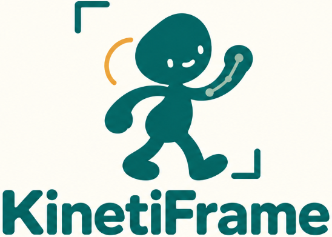
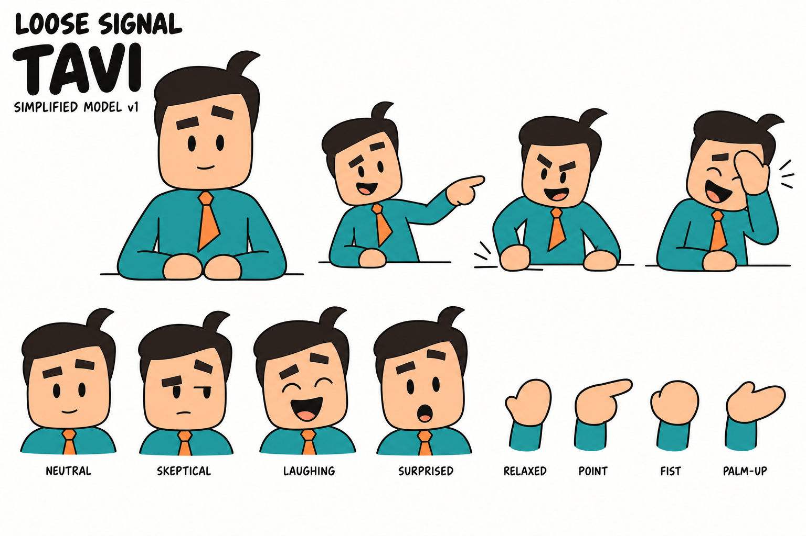

<p align="center">
  
</p>

<p align="center">
  <strong>A free, open-source 2D animation studio for Android.</strong><br>
  Draw frame by frame, animate rigged characters, and mix both in one scene.
</p>

<p align="center">
  <a href="https://github.com/DonnC/kinetiframe/actions/workflows/ci.yml"></a>
  <a href="LICENSE"></a>
  
  <a href="CONTRIBUTING.md"></a>
</p>

---

Most mobile animation apps make you choose: hand-draw every frame, or move a puppet around.
KinetiFrame does both. Sketch a scene frame by frame, drop in a rigged character, act out its
movement with your finger, and add a voice-over and a camera move. Then export a video or
share the editable project.

It works offline, needs no account and has no ads, in-app purchases or tracking.

## What you can make

**Frame-by-frame animation**
- Brushes, eraser, fill, lasso cut, smudge, blur and text
- Layers, onion skinning, grids and rulers
- A frame timeline with held drawings, so one drawing can stay on screen for several frames
- Stamp packs: reusable sets of drawings you can drag onto any frame

**Rigged characters (actors)**
- Build a skeleton and attach cutout artwork or a whole continuous drawing to it
- Pose with inverse kinematics: drag a hand and the arm follows
- Separately drawn front, back, profile and three-quarter views
- Record a *performance* by moving the character in real time, then reuse it in any project

**Scenes**
- Audio tracks, voice recording and imported video clips
- Camera moves: push in, pull out, pan, tilt, shake, whip pan, follow and fades
- MP4 video export, plus `.kframe` project files and `.kpack` stamp packs you can share

New to the terms? The [glossary](docs/glossary.md) explains actors, rigs, performances and the rest.

## Meet the sample cast

KinetiFrame ships with three ready-to-animate characters: Tavi, Mira and Kuda. Each is drawn
from four directions and comes with hand poses and facial expressions, so you can try character
animation before drawing your own.

<p align="center">
  
</p>

## Try it

Development builds are published on [Releases](https://github.com/DonnC/kinetiframe/releases)
after every successful build of `develop`. They install next to any stable copy as
`com.donnclab.kinetiframe.dev`. KinetiFrame needs **Android 9 (API 28) or newer**. A phone or
tablet with a stylus is the best way to try it.

The [user guide](docs/user-guide.md) walks through your first scene.

## Build from source

You need **JDK 17** and **Android SDK platform 37**. Gradle is downloaded by the wrapper.

```sh
git clone https://github.com/DonnC/kinetiframe.git
cd kinetiframe
./gradlew :app:assembleDebug      # Windows: gradlew.bat :app:assembleDebug
```

The APK is written to `app/build/outputs/apk/debug/`. To build and run every check that CI runs:

```sh
./gradlew verify
```

Working only on rigging or deformation math? `./gradlew :engine:testDebugUnitTest` runs just the
engine's tests.

[Development setup](docs/development.md) covers Android Studio, device tests and troubleshooting.

## Get involved

Everyone is welcome, whether you write code or not.

| You are... | You can help by... | Start here |
| --- | --- | --- |
| An animator | Testing builds, reporting what gets in your way, sharing sample scenes | [Report a bug](https://github.com/DonnC/kinetiframe/issues/new/choose) |
| An illustrator | Drawing actor kits, stamp packs, backgrounds and brushes | [Asset guide](docs/assets.md) |
| An Android developer | Fixing bugs, building features, improving performance | [Contributing](CONTRIBUTING.md) |
| A UI designer | Improving controls and screens with Compose previews, no project needed | [UI contributions](docs/ui-contributions.md) |
| Into math or graphics | IK, skinning, interpolation and rendering in the engine | [Engine](engine/README.md) |
| A writer or translator | Improving guides, translating the app | [Roadmap](ROADMAP.md) |

Look for issues labeled
[`good first issue`](https://github.com/DonnC/kinetiframe/labels/good%20first%20issue) to find a
small, well-defined place to start.

## How it is built

KinetiFrame is a Kotlin and Jetpack Compose app split into a few Gradle modules:

| Module | What it holds |
| --- | --- |
| [`app`](app/README.md) | The Android app: screens, editor, media, persistence and wiring |
| [`core`](core/README.md) | Plain Kotlin data models, file codecs and validation. No Android |
| [`engine`](engine/README.md) | Rigging, IK, deformation, timing and motion presets |
| [`data`](data/README.md) | Durable file storage |
| [`presentation`](presentation/README.md) | Shared ViewModel (MVI) infrastructure |
| [`designsystem`](designsystem/README.md) | Theme, design tokens and reusable Compose controls |

Read the [architecture overview](docs/architecture/README.md) for how a stroke becomes a frame
and how a performance becomes a pose. Project and pack files are described in
[file formats](docs/file-formats.md).

## Project status

KinetiFrame is in active development and has not had a stable release yet. Drawing, projects,
the library, actors, performances, audio and video export all work. Actor setup, artwork
deformation and performance editing still need refinement on real devices. See the
[roadmap](ROADMAP.md) for what is planned next.

## Community

- [Code of conduct](CODE_OF_CONDUCT.md)
- [Governance](GOVERNANCE.md): who decides what, and how to become a maintainer
- [Security policy](SECURITY.md): report vulnerabilities privately
- [Changelog](CHANGELOG.md)

## License

KinetiFrame's code, documentation, sample artwork and audio are released under the
[Apache License 2.0](LICENSE). Third-party libraries keep their own licenses; see
[NOTICE](NOTICE) and [THIRD_PARTY_NOTICES.md](THIRD_PARTY_NOTICES.md).
