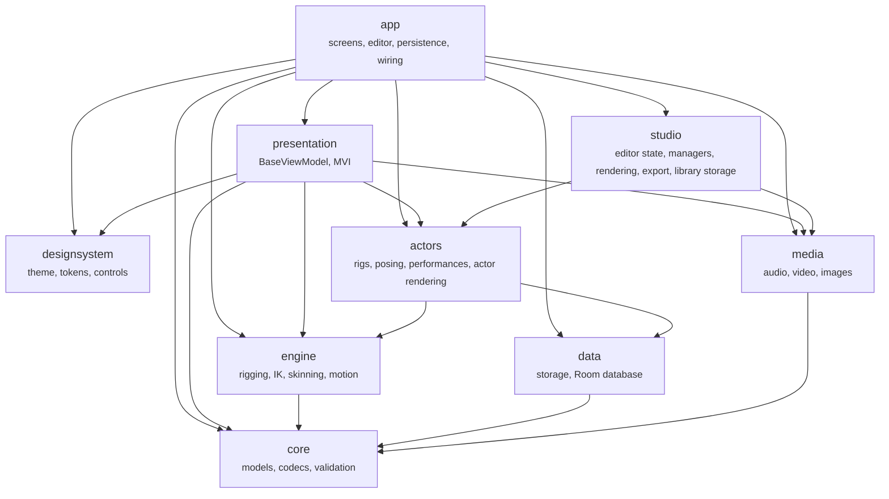
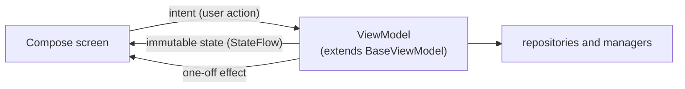
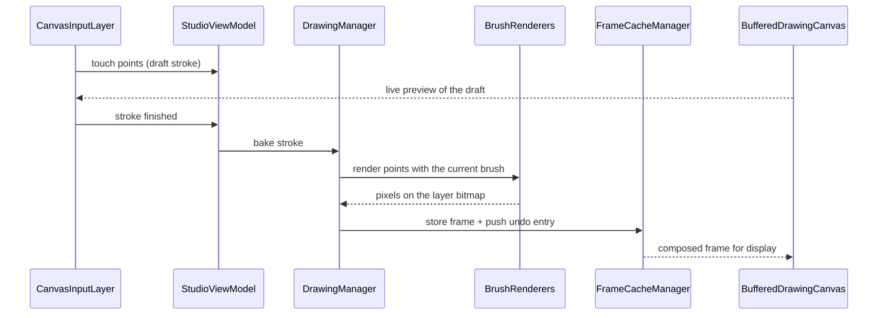
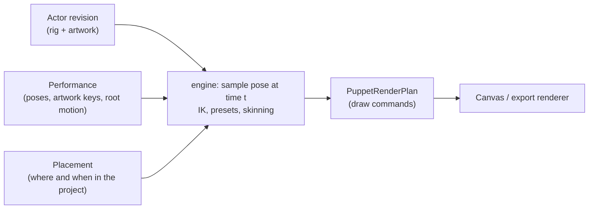
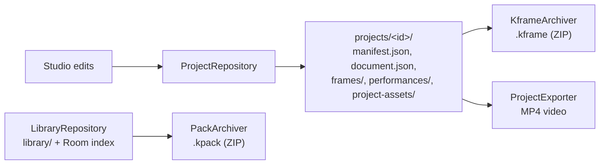

# Architecture

This page explains how KinetiFrame is put together: the modules, how they depend on each other,
and how data moves through the app when you draw, animate an actor, save and export. Read the
[glossary](../glossary.md) first if terms such as *actor*, *placement* or *performance* are new.

## Modules

| Module | Type | Responsibility |
| --- | --- | --- |
| [`app`](../../app/README.md) | Android app | Entry point, navigation, the editor and other screens still to move to `presentation`, bundled assets |
| [`core`](../../core/README.md) | Kotlin/JVM | The project document and platform-neutral records for actors, rigs, motion and presets; JSON codecs; validation; service contracts; the MVI `StateStore` |
| [`engine`](../../engine/README.md) | Android library | IK (FABRIK and two-bone), world transforms, skin deformation, artwork registration, pose and curve sampling, performance clocks, motion presets |
| [`data`](../../data/README.md) | Android library | Crash-safe file writes, the document file store, the Room database, project storage and crash reports |
| [`studio`](../../studio/README.md) | Android library | The editor's state, managers, drawing tools, frame rendering and caches, camera, playback, video export, and library storage |
| [`actors`](../../actors/README.md) | Android library | Actor storage, rig math, posing, performances and actor rendering |
| [`media`](../../media/README.md) | Android library | Audio decoding, mixing, recording and trimming; imported video decoding and framing; background image decoding |
| [`presentation`](../../presentation/README.md) | Android library | Screens and components with their ViewModels, and `BaseViewModel`; the rest of the screens are moving here from `app` |
| [`designsystem`](../../designsystem/README.md) | Android library | Compose theme, design tokens and reusable controls |

Dependencies only point downward. `./gradlew checkArchitecture` fails the build if code imports
across a boundary it shouldn't, for example Android types in `core` or Compose in engine math.
[Module boundaries](modules.md) has the full rules.

### Work in progress

Most product code still lives in `app`, organised by feature as described in the
[project architecture](decisions/project-architecture.md) decision. Code moves from `app` into a
library module when everything it depends on can move with it. Package names never repeat a
module name, so `com.donnclab.kinetiframe.engine` is always the `engine` module.

## Where to find things

Paths are under each module's `src/main/java/com/donnclab/kinetiframe/`. Rows that name no module
are in `app`.

| Area | Package |
| --- | --- |
| Activity and navigation | `MainActivity.kt`, `navigation` |
| Home and Settings | `presentation` module, `presentation/home` and `presentation/settings`; the project gallery and new-project flow in `presentation/project` |
| The studio (main editor) | `presentation` module, `presentation/studio` (`EditorScreen.kt`, `StudioViewModel.kt`, and the editor's slots in `editor`); `StudioState`, `StudioIntent` and `StudioSession` in the `studio` module |
| Canvas input and drawing surface | `presentation` module, `presentation/studio/canvas` |
| Editor toolbars and menus | `presentation` module, `presentation/studio/dock` and `presentation/studio/timeline` |
| Brushes and drawing tools | `studio` module, `studio/drawing` |
| Frame and bitmap caches | `studio` module, `studio/render` and `studio/drawing` |
| Stroke, undo, layer and selection coordination | `studio` module, `studio/domain` |
| Actor Studio | `presentation` module, `presentation/studio/actorstudio` (with `rigging` and `sketch`); its managers in the `studio` module, `studio/domain/actorstudio` |
| Actor library screens and dialogs | `presentation` module, `presentation/actors` |
| Actor posing, placements and performances | `actors` module, `actors/domain` and `actors/rig` |
| Rendering actors | `actors` module, `actors/render` and `actors/rig/texture` |
| Camera effects | `studio` module, `studio/camera`; shot evaluation is `SceneCamera` in `engine` |
| Library | `presentation` module, `presentation/library` and `presentation/library/catalog`; `library/data` and `library/bundled` in the `studio` module |
| Stamp packs | `presentation` module, `presentation/library/packs`; `library/data/PackArchiver.kt` in the `studio` module |
| Projects on disk | `data` module, `data/project`; `.kframe` archives in the `studio` module, `project/data` |
| Actors and performances on disk | `actors` module, `actors/data` |
| Video export | `presentation` module, `presentation/export`; `export/data` in the `studio` module |
| Audio and imported video clips | `media` module, `media/audio` and `media/video`; the recorder and trimmer in `presentation/media/audio` |
| Studio audio and video playback | `studio` module, `studio/media` |
| Shared app UI | `presentation` module, `presentation/common` |

## How the app is structured

Screens follow **Model-View-Intent (MVI)**:

- A *route* composable gets the ViewModel with `appViewModel()` and collects its state. The
  screen content below it is stateless and previewable.
- The ViewModel is the only place state changes. It handles every intent explicitly.
- Effects are for things that happen once, such as navigating or showing a message.

### Where dependencies come from

`AppContainer`, in `app`, creates every shared object once: the database, the document store
under `actor-studio/`, the repositories and the preference store. `AppViewModelFactory` builds
each ViewModel from it, and `MainActivity` provides that factory to the UI as
`LocalViewModelFactory`. A route asks for its ViewModel with `appViewModel()`, passing values such
as the document it edits as creation extras. Screens don't open the database or build stores.
The [dependency wiring](decisions/dependency-wiring.md) decision explains why this is a
container rather than Hilt.

To add a ViewModel: give it its dependencies as constructor parameters, add one `initializer`
block to `AppViewModelFactory`, and call `appViewModel()` from its route. If it needs a value
per screen, declare a `CreationExtras.Key` in its companion object and set it in the route.

The studio's ViewModel is `StudioViewModel`. It
delegates focused jobs to managers, such as `DrawingManager` in `studio/domain` for strokes and
undo, and `RiggingManager` in `studio/domain/actorstudio` for actor editing.

## Drawing a stroke

While your finger is down, the stroke is a draft and is drawn as a preview. Only when it ends is
it *baked* into the layer's bitmap, off the main thread, and recorded for undo. Frames are kept in
a bounded cache in memory and written to the project's `frames/` folder when saved. Cancelling a
gesture throws the draft away without touching saved pixels.

## Animating an actor

1. An **actor revision** holds the rig (a `SceneGraph` of bones) and the artwork attached to each
   bone. Revisions never change once saved; editing an actor creates a new one.
2. A **performance** stores how the actor moves over time: sampled poses, artwork switches and
   root motion, or an applied motion preset.
3. A **placement** puts one actor revision and one performance into a project at a position and
   time range.
4. For each frame, the engine samples the performance at that moment, solves any IK, and computes
   world transforms and skin deformation. The result depends only on the inputs and the time,
   never on which frame was shown before, so scrubbing and export give identical results.
5. `PuppetRenderPlan` turns the pose into a list of draw commands: an artwork ID, a transform
   matrix and, for continuous drawings, a deformed mesh. The commands hold asset IDs rather than
   bitmaps; the bitmaps themselves are owned by `RigAssetManager`.

## Saving, sharing and exporting

- A project is edited in place as a folder of JSON and PNG files. Writes go through
  `DurableFile`, which writes to a temporary file and swaps it in, so a crash never leaves a
  half-written file.
- A `.kframe` is only created when you share or back up a project. It bundles the project folder
  and every actor it uses. See [file formats](../file-formats.md).
- Library items live under `library/` with a Room database as a searchable index. The files are
  the source of truth.
- Video export renders each frame (drawings, actors, camera move) and encodes it with Android's
  media codecs, together with the audio tracks.

## Design principles

- **Saved work must keep opening.** Serialized names and defaults never change silently. Format
  changes come with compatibility tests and a migration.
- **The engine is deterministic.** Same inputs and time, same pose.
- **Bounded memory.** Caches, bitmap pools and undo history all have size limits and an owner who
  clears them.
- **No hidden services.** Dependencies are passed in where objects are created; there is no global
  registry.
- **Offline first.** Nothing needs an account or network connection.

## Decisions

Important choices are recorded as architecture decision records:

- [Project architecture](decisions/project-architecture.md)
- [Design system boundary](decisions/design-system-boundary.md)
- [Library-only sharing](decisions/library-only-sharing.md)
- [Standard parameter limits](decisions/parameter-limits.md)
- [Feature modules](decisions/feature-modules.md)
- [UI in presentation](decisions/ui-in-presentation.md)
- [Dependency wiring](decisions/dependency-wiring.md)

See also [module boundaries](modules.md), [code guidelines](../code-guidelines.md),
[development setup](../development.md) and [UI contributions](../ui-contributions.md).
